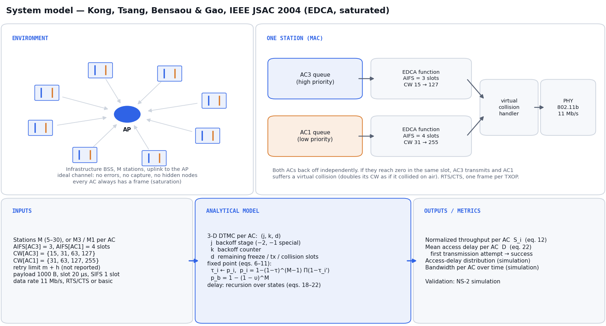
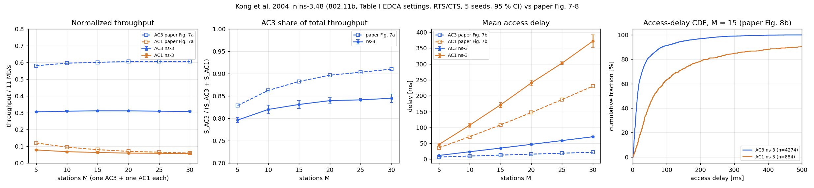
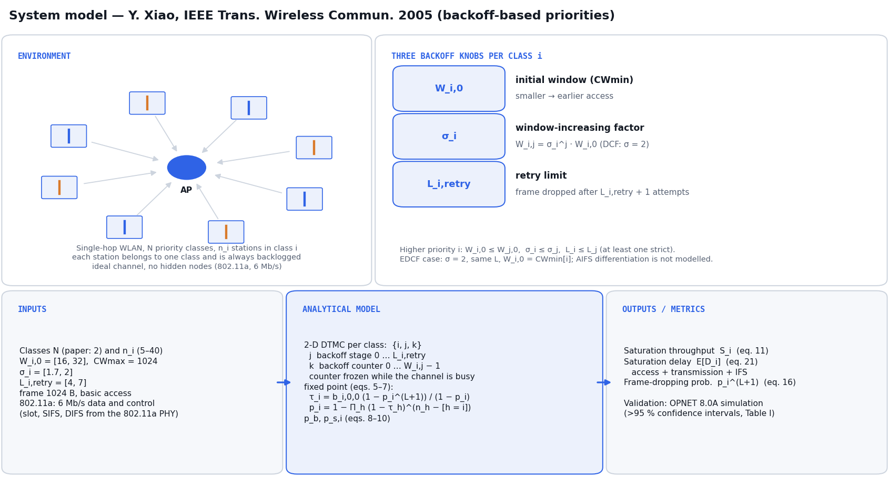
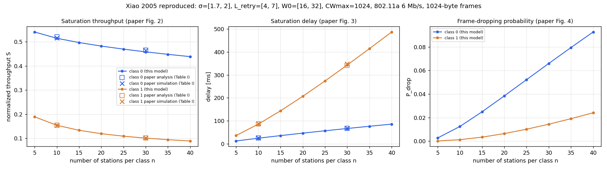
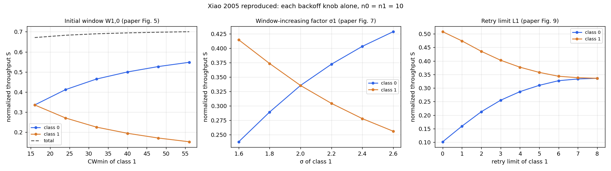

# A3 — Literature Review: IEEE 802.11e EDCA

**Path:** Basic — 802.11e reproduction · **Topic:** Optimal QoS policy under different traffic models

This note studies two IEEE papers that model how IEEE 802.11e gives different traffic classes different service, and turns them into experiments that can be run:

| # | Paper | Venue | What it gives this project |
|---|---|---|---|
| P1 | Z. Kong, D. H. K. Tsang, B. Bensaou, D. Gao, "Performance analysis of IEEE 802.11e contention-based channel access" | IEEE JSAC, vol. 22, no. 10, pp. 2095–2106, Dec. 2004. DOI [10.1109/JSAC.2004.836019](https://doi.org/10.1109/JSAC.2004.836019) | The EDCA model with **AIFS, CW and virtual collisions**; a simulation baseline to reproduce in ns-3 |
| P2 | Y. Xiao, "Performance analysis of priority schemes for IEEE 802.11 and IEEE 802.11e wireless LANs" | IEEE Trans. Wireless Commun., vol. 4, no. 4, pp. 1506–1515, Jul. 2005. DOI [10.1109/TWC.2005.850328](https://doi.org/10.1109/TWC.2005.850328) | A simpler model of the **backoff knobs** (initial window, window-increasing factor, retry limit) with **frame-dropping probability**; exact numbers to validate against |

Both papers were not only read but **partly reproduced** for this note:

- P2's analytical model was re-implemented and checked against the paper's Table I ([`codes/a3/xiao_model.py`](codes/a3/xiao_model.py)).
- P1's simulation scenario was rebuilt in **ns-3.48** with the paper's Table I settings and run for 6 network sizes × 5 seeds ([`codes/a3/kong-edca.cc`](codes/a3/kong-edca.cc)).

Doing so exposed settings the papers never state and two places where their numbers do not add up; those findings shaped the [revised proposal](#4-revised-project-proposal).

| File | Purpose |
|---|---|
| [`codes/a3/xiao_model.py`](codes/a3/xiao_model.py) | P2's analytical model, eqs. (1)–(21); prints the Table I comparison |
| [`codes/a3/plot_xiao.py`](codes/a3/plot_xiao.py) | Reproduces P2's Figs. 2–5, 7, 9 and Table I points |
| [`codes/a3/kong-edca.cc`](codes/a3/kong-edca.cc) | ns-3.48 scenario with P1's Table I settings (802.11b EDCA, RTS/CTS, saturated) |
| [`codes/a3/kong_ns3_sweep.csv`](codes/a3/kong_ns3_sweep.csv), [`delays_n15.csv`](codes/a3/delays_n15.csv) | Raw ns-3 results: M = 5…30, seeds 1–5; access-delay samples at M = 15 |
| [`codes/a3/plot_kong.py`](codes/a3/plot_kong.py) | Compares the ns-3 runs with P1's Figs. 7–8 |
| [`codes/a3/draw_system_models.py`](codes/a3/draw_system_models.py) | Draws the system-model diagrams |

---

## 1. Background in one paragraph

Plain IEEE 802.11 (DCF) treats every frame the same: a station senses the channel idle for a DIFS, waits a random backoff drawn from a contention window (CW), transmits, and doubles CW after every collision. 802.11e adds **EDCA**: traffic is split into four **access categories (ACs)** — voice, video, best effort, background — each with its own queue and its own contention parameters. A higher-priority AC gets a shorter wait before it may count down (**AIFS**, arbitration inter-frame space), a smaller window (**CWmin/CWmax**), and possibly a different **retry limit**. When two ACs of the same station finish their backoff in the same slot, the higher one transmits and the lower one suffers a **virtual collision**. Both papers answer the same question with Markov-chain models: *how much throughput and delay does each class get for a given set of these parameters?*

---

## 2. Paper P1 — Kong et al., IEEE JSAC 2004

### 2.1 Problem, importance, challenges

**Problem.** EDCA is the mandatory QoS mechanism of 802.11e, but at the time it had been studied only by simulation. The established analytical models — Bianchi's Markov chain for DCF and its extensions — capture none of EDCA's new features. P1 builds an analytical model of EDCA and uses it to compute per-AC throughput and mean access delay.

**Importance.** Voice and video need bounded delay. Whether EDCA actually protects them, and how its parameters should be set, depends on how AIFS and CW interact under load. A model answers this for any parameter set in seconds, where a simulation needs one long run per point.

**Challenges** (what makes EDCA harder than DCF):
1. **Different AIFS per AC** — after every busy period a low-priority AC must stay idle longer before its counter can move, so the ACs effectively see different channels. The model needs a third state dimension for the remaining frozen time.
2. **Virtual collisions** couple the ACs *inside* one station, not only across stations.
3. **EDCA's countdown differs from DCF's**: the counter is decremented in the last slot of the AIFS, not the slot after it.
4. **Finite retry limit**, ignored by the earlier models.
5. The resulting equations are a coupled **non-linear fixed point** across ACs and stations, and the mean delay needs a **recursion** over all states.

### 2.2 System model



| | |
|---|---|
| **Environment** | Infrastructure BSS with M stations sending uplink to the AP; ideal channel (no errors, no capture effect, no hidden nodes); **saturation** — every AC always has a frame to send. Each station runs two ACs: AC3 (high priority) and AC1 (low priority). |
| **Inputs** | Number of stations M (5–30), or M₃ and M₁ stations per AC in the heterogeneous case; AIFS[AC3] = 3 slots, AIFS[AC1] = 4 slots; CW[AC3] = {15, 31, 63, 127}, CW[AC1] = {31, 63, 127, 255}; retry limit m + h; payload 1000 bytes; slot 20 µs, SIFS = 1 slot; 11 Mb/s; RTS/CTS (basic access also derived). |
| **Model** | A three-dimensional discrete-time Markov chain per AC, state (j, k, d): backoff stage j, backoff counter k, and d = remaining frozen / transmission / collision slots. The chains are coupled through the collision probability pᵢ and the channel-busy probability p_b (eqs. 6–11), solved numerically. |
| **Outputs** | Normalized throughput per AC Sᵢ (eq. 12); mean access delay per AC — time from the first transmission attempt of a frame until it is successfully transmitted (eqs. 18–22). From simulation also the bandwidth over time and the access-delay distribution. |
| **Performance metrics** | Normalized throughput, mean access delay, access-delay CDF, and the *differentiation* between AC3 and AC1. |

### 2.3 Experimental results reported in the paper

Validation is against **NS-2**. All numbers below are read off the paper's figures.

| Figure | Experiment | Result |
|---|---|---|
| Fig. 7 | One AC3 + one AC1 per station, M = 5…30 | AC3 throughput stays at ≈ 0.58–0.61 while AC1 halves from ≈ 0.12 to ≈ 0.06. AC1 delay grows linearly to ≈ 230 ms at M = 30; AC3 stays below ≈ 25 ms. Model and NS-2 agree. |
| Fig. 8 | M = 15, simulation | AC3 ≈ 6.5 Mb/s, AC1 ≈ 1 Mb/s. Almost all AC3 frames are delivered within 100 ms; AC1 has a long tail beyond 300 ms. |
| Fig. 9 | CW[AC3] = {7…63}, {15…127}, {31…255} | A smaller AC3 window raises AC3 throughput and pushes AC1 back. With *equal* windows, AC3 still wins — because of its shorter AIFS. |
| Fig. 10 | AIFS[AC1] = 3, 4, 5 | AIFS is a very effective lever, but AIFS[AC1] = 5 drives AC1 delay to ≈ 1.1 s at M = 30: **starvation** of the low class under heavy load. |
| Figs. 11–12 | M₃ stations with only AC3, M₁ with only AC1 | More AC3 stations hurt AC1 badly; more AC1 stations barely affect AC3. The paper concludes that the number of high-priority flows should be limited, i.e. admission control is needed. |

### 2.4 ns-3 settings needed to reproduce Fig. 7–8

| Item | Paper (Table I and §V) | ns-3.48 setting used | Note |
|---|---|---|---|
| Topology | infrastructure, M stations, ideal channel | 1 AP + M STAs on a 5 m circle, `YansWifiChannel` default, `ConstantPositionMobilityModel` | no hidden nodes, no frame errors at 5 m |
| Traffic model | saturated, AC3 + AC1 per station, payload 1000 B | 2 × `PacketSocketClient` per STA, 1000 B every 2 ms (4 Mb/s, well above the attainable rate), `Priority` 6 (→ AC_VO) and 1 (→ AC_BK) | AC3 ↦ AC_VO, AC1 ↦ AC_BK |
| PHY | 11 Mb/s data, PHY header 192 bits | `WIFI_STANDARD_80211b`, `ConstantRateWifiManager` DataMode = ControlMode = `DsssRate11Mbps` | **see finding F1** |
| Slot / SIFS | 20 µs / 1 slot | slot 20 µs (802.11b default); `WifiPhy::SetSifs(20 µs)` | the 802.11b standard SIFS is 10 µs; set to the paper's value |
| AIFS | AC3 3 slots, AC1 4 slots | `Aifsns` = {2} for VO, {3} for BK | AIFS = SIFS + AIFSN × slot |
| CW | AC3 15–127, AC1 31–255 | `MinCws` / `MaxCws` on `VO_Txop` and `BK_Txop`, set on AP and STAs | STAs adopt the AP's EDCA Parameter Set on association |
| Access | RTS/CTS, one frame per TXOP | `RtsCtsThreshold` = 0, `TxopLimits` = {0} | |
| Retry limit | m + h — **not reported** | `FrameRetryLimit` = 7 (ns-3 default) | CW lists imply m = 3 |
| Simulation time | **not reported** | 13 s: traffic from 2 s, statistics 3–13 s | traffic starts after association (finding F3) |
| Seeds / runs | **not reported** | `RngRun` 1–5, mean ± 95 % CI | |
| Metrics | throughput / 11 Mb/s; access delay | payload received at the AP / 10 s / 11 Mb/s; per STA and AC, head-of-line → ACK time (`AckedMpdu`, `DroppedMpdu` traces) | |

Run: `./ns3 run "kong-edca --nSta=15 --seed=1"`; the sweep used `M ∈ {5, 10, 15, 20, 25, 30}` × seeds 1–5.

### 2.5 What the ns-3 reproduction showed



| M | S_AC3 ns-3 | S_AC1 ns-3 | AC3 share ns-3 / paper | D_AC3 ns-3 [ms] | D_AC1 ns-3 [ms] |
|---|---|---|---|---|---|
| 5 | 0.306 | 0.078 | 0.80 / 0.83 | 11.9 | 46 |
| 10 | 0.309 | 0.068 | 0.82 / 0.86 | 23.5 | 107 |
| 15 | 0.311 | 0.063 | 0.83 / 0.88 | 35.0 | 171 |
| 20 | 0.311 | 0.059 | 0.84 / 0.90 | 46.8 | 240 |
| 25 | 0.309 | 0.058 | 0.84 / 0.90 | 58.8 | 303 |
| 30 | 0.308 | 0.057 | 0.85 / 0.91 | 70.8 | 372 |

The **qualitative** result reproduces: AC3 throughput is flat in M, AC1's shrinks, AC1's delay grows linearly and much faster than AC3's, and AC3's share of the channel rises with M. At M = 15, 91 % of AC3 frames but only 63 % of AC1 frames are delivered within 100 ms, the same contrast as the paper's Fig. 8b. The **absolute** numbers do not, for reasons that matter for A4:

- **F1 — The paper's PHY is idealized.** Table I lists the PHY header as "192 bits" and uses one 11 Mb/s rate, i.e. the header costs ≈ 17 µs. Real 802.11b (and ns-3) sends the long PLCP preamble + header at 1 Mb/s: **192 µs**, on every RTS, CTS, DATA and ACK. An RTS-CTS-DATA-ACK cycle takes ≈ 977 µs in the paper's accounting but ≈ 1 475 µs in reality, which caps the normalized throughput at ≈ 0.74 versus ≈ 0.49. The paper's total of ≈ 0.70 is only reachable with the idealized header, so ns-3's AC3 throughput is about half. The AC3 *share* (which cancels the overhead) and AC1's throughput (≈ 0.06–0.08, close to the paper) are the fair comparisons.
- **F2 — The delay definition is ambiguous.** Under saturation, Little's law fixes the mean head-of-line delay at 1 / (frames per second per station). For ns-3 at M = 30 that is 30 × 727 µs / 0.31 ≈ 70 ms — exactly what was measured. Applied to the paper's own AC3 throughput (≈ 0.605) the same bound is ≈ 36 ms, yet Fig. 7b shows ≈ 22 ms. Either many AC3 frames are dropped at the (unreported) retry limit, or "from the first transmission attempt" excludes the initial backoff. A4 must fix one definition and state it.
- **F3 — Association must finish before saturation.** In the first ns-3 runs, traffic started at 0.2 s. At M = 30, association frames competed with saturated data, some stations were not yet known to the AP, and their ACKed frames were discarded: throughput fell to 0.24 in 2 of 3 seeds. Starting traffic at 2 s (all 30 associated) fixed it. The paper's NS-2 runs had no association phase, so this is a reproduction pitfall, not a paper error.

---

## 3. Paper P2 — Xiao, IEEE Trans. Wireless Commun. 2005

### 3.1 Problem, importance, challenges

**Problem.** DCF gives every station the same chance, so a voice frame may wait arbitrarily long. Earlier priority schemes for 802.11 were evaluated only by simulation, or with models that assume an infinite retry limit and cannot report frame loss. P2 proposes and analyses **backoff-based priority schemes** that differentiate three knobs per class — the initial window W_{i,0}, the window-increasing factor σᵢ, and the retry limit L_{i,retry} — and treats the backoff side of EDCA as a special case.

**Importance.** All three knobs need only small changes to the DCF code. A model giving throughput, delay *and* frame-dropping probability per class lets a designer pick values for a target service mix — in particular the retry limit, which trades loss against delay for real-time traffic.

**Challenges:**
1. A **finite retry limit** changes the chain's structure and is what makes frame loss computable.
2. The backoff counter **freezes** while the channel is busy.
3. Several classes are coupled through one shared collision process — a fixed point in τᵢ and pᵢ.
4. An **accurate delay model** — the paper's acknowledgment thanks Bianchi for pointing out an error in the original delay model.

### 3.2 System model



| | |
|---|---|
| **Environment** | Single-hop WLAN with N priority classes and nᵢ stations in class i; each station belongs to one class and is always backlogged (saturation); ideal channel, no hidden nodes. |
| **Inputs** | N = 2 classes, nᵢ = 5…40; W_{i,0} = [16, 32], CW_max = 1024; σᵢ = [1.7, 2]; L_{i,retry} = [4, 7]; 1024-byte frames, basic access; IEEE 802.11a at 6 Mb/s for data and control. One knob is varied at a time in Figs. 5–11. |
| **Model** | A two-dimensional DTMC per class, state {i, j, k}: backoff stage j = 0…L_{i,retry}, backoff counter k = 0…W_{i,j} − 1, with W_{i,j} = σᵢʲ W_{i,0} capped at CW_max (eq. 1). Fixed point between the transmission probability τᵢ (eqs. 5–6) and the collision probability pᵢ (eq. 7). |
| **Outputs** | Saturation throughput Sᵢ (eq. 11); saturation delay E[Dᵢ] — access + transmission + inter-frame spaces (eq. 21); frame-dropping probability P_{i,drop} = pᵢ^{L+1} (eq. 16). |
| **Performance metrics** | Per-class throughput, delay and frame-dropping probability, and how much one class gains at the other's expense. |

### 3.3 Experimental results reported in the paper

Validation is against **OPNET 8.0A** simulation with > 95 % confidence intervals (Table I).

| Figure | Experiment | Result |
|---|---|---|
| Table I | n₀ = n₁ = 10 and 30 | Analysis vs simulation within 0.45–2.2 %. Example: class 0 throughput 0.5208 (analysis) vs 0.5161 (simulation) at n = 10. |
| Figs. 2–4 | combined scheme vs n | Class 0 gets much higher throughput and much lower delay; but with its smaller retry limit it drops more frames (≈ 9 % vs ≈ 2.4 % at n = 40). |
| Figs. 5–8 | W_{1,0} = 16…56, σ₁ = 1.6…2.6 | Each knob alone moves bandwidth from one class to the other, and total throughput rises slightly (fewer collisions). |
| Figs. 9–11 | L_{1,retry} = 0…8 | A smaller retry limit gives better throughput and delay at the cost of more dropped frames — suited to loss-tolerant, delay-sensitive traffic such as voice. |

### 3.4 Analytical reproduction

[`xiao_model.py`](codes/a3/xiao_model.py) implements eqs. (1)–(21) with standard 802.11a timing at 6 Mb/s (slot 9 µs, SIFS 16 µs, DIFS 34 µs, 20 µs preamble + SIGNAL, 28-byte MAC header + FCS, 14-byte ACK):

| | n | this model | paper analysis | error | paper's own sim-vs-analysis error |
|---|---|---|---|---|---|
| S, class 0 | 10 | 0.5150 | 0.5208 | −1.1 % | −0.9 % |
| S, class 1 | 10 | 0.1538 | 0.1547 | −0.6 % | −1.0 % |
| delay, class 0 | 10 | 24.4 ms | 25.1 ms | −2.6 % | +1.8 % |
| delay, class 1 | 10 | 85.9 ms | 86.5 ms | −0.7 % | +2.2 % |
| S, class 0 | 30 | 0.4585 | 0.4659 | −1.6 % | −0.5 % |
| S, class 1 | 30 | 0.1004 | 0.1013 | −0.9 % | −0.5 % |
| delay, class 0 | 30 | 66.7 ms | 67.0 ms | −0.4 % | +1.1 % |
| delay, class 1 | 30 | 343.3 ms | 342.3 ms | +0.3 % | +1.9 % |

The mean error is **1.0 %**, the same size as the paper's own simulation-vs-analysis error. Testing other plausible PHY constants and integer rounding of W_{i,j} gets no closer than ≈ 0.6 %: the paper defers its exact PHY timing to its references [5], [15], so this residual cannot be closed from the paper alone.





Figs. 2–5 and 9 match the paper's curves (e.g. class 1 delay ≈ 487 ms vs ≈ 485 ms at n = 40; dropping probability of class 0 ≈ 0.093 at n = 40). One figure does not:

- **F4 — Fig. 7 is not reproducible from the stated parameters.** At σ₁ = 1.6 the paper shows class 0 at ≈ 0.18; the model gives 0.24, and no rounding of W or removing the CW_max cap closes the gap. The paper is also inconsistent with itself: the identical configuration (σ₀ = σ₁ = 2, L = 7, W = 16, n = 10) appears at ≈ 0.34 in Figs. 5 and 9 but at ≈ 0.325 in Fig. 7. Fig. 7 was most likely produced with a setting the paper does not report.

### 3.5 ns-3 settings needed to reproduce

| Item | Paper | ns-3.48 setting | Note |
|---|---|---|---|
| Topology | n₀ + n₁ stations, one class per station, 5–40 per class | 1 AP + (n₀ + n₁) STAs, or ad hoc, all within range | |
| Traffic model | saturated, fixed 1024-byte frames | one saturating `PacketSocketClient` per STA, 1024 B, priority by class | |
| PHY | 802.11a, 6 Mb/s data and control | `WIFI_STANDARD_80211a`, DataMode = ControlMode = `OfdmRate6Mbps` | matches the paper's PHY exactly (no idealization like P1) |
| Access | basic | `RtsCtsThreshold` above 1024 B | |
| Initial window, CW_max | W₀ = [16, 32], CW_max = 1024 | `MinCws` = {15}, {31}; `MaxCws` = {1023} | ns-3 stores CW − 1 |
| Window-increasing factor | σ = [1.7, 2] | **not supported** — ns-3 hard-codes CW = 2^QSRC (CWmin + 1) − 1 in `Txop::UpdateFailedCw` | needs a small patch, or keep σ = 2 |
| Retry limit | L = [4, 7] per class | `FrameRetryLimit` per MAC | works because each station carries one class |
| AIFS | equal for all classes | `Aifsns` = {2} for both | |
| Simulation time / seeds | > 95 % CI, duration not reported | ≥ 10 s after association, 10 seeds | |

---

## 4. Revised project proposal

### 4.1 What both papers leave open

Both papers — and almost every model in their family — assume **saturation**: every queue always has a frame. Their parameter recommendations (smaller CW and AIFS for voice, a smaller retry limit for loss-tolerant traffic) are therefore derived for a network that is permanently overloaded. Real multimedia traffic is not like that: voice is periodic and light, XR video arrives in frame bursts every 16.7 ms (A2), and the load changes over the day (A1). P1 itself shows the danger of tuning for overload: AIFS[AC1] = 5 starves the low class. Under realistic traffic the best parameter set may be different, and a set that looks safe under saturation may waste capacity or starve a class.

### 4.2 What changed from A1, and why

| | A1 proposal | Revised (A3) | Why it changed |
|---|---|---|---|
| Technology | IEEE 802.16 OFDMA connection admission control | **IEEE 802.11e EDCA** | The course path is *Basic — 802.11e*. ns-3.48 has **no WiMAX module** (checked: `src/` has no `wimax`), so the A1 plan could not be reproduced in A4; ns-3's `wifi` module implements EDCA fully. |
| Base papers | El Bouchti, El Kafhali & Haqiq — published in IJCSIS 2011, **not an IEEE venue** | Kong et al. (IEEE JSAC 2004) and Xiao (IEEE TWC 2005) | A3 requires IEEE papers; both come with validated models and reproducible baselines (§2.5, §3.4). |
| QoS lever ("policy") | one admission threshold C | **per-AC EDCA parameters**: CWmin, CWmax, AIFSN, retry limit (σ optional) | These are exactly the knobs 802.11e exposes, and P1/P2 quantify their effect. |
| Traffic model | two-state MMPP with time-of-day λ₁(t) | saturated (baseline) → Poisson → two-state MMPP → **3GPP XR video** (A2 generator) → time-of-day load λ(t) | The papers' saturation assumption is the gap; the MMPP and λ(t) ideas from A1 and the XR model from A2 are reused. |
| Method | DTMC solved numerically + ns-3 WiMAX cross-check | P2's analytical model (implemented, 1 % from the paper) + **ns-3 802.11e simulation** (P1's scenario, implemented) | Both tools now exist and are validated; ns-3 is protocol-accurate where the papers idealize (finding F1). |
| Metrics | blocking, drop probability, delay, throughput | per-AC throughput, **mean and 95th-percentile access delay**, frame-dropping probability, **delay-budget violations**, starvation of the lowest AC | Delay tails and budget violations matter for XR (10 ms budget, A2); P1's starvation result makes fairness a metric. |
| Kept from A1 | — | time-varying load λ(t); quasi-static vs dynamic analysis; convexity argument (averaging the load understates delay) | These ideas do not depend on the radio technology. |

### 4.3 Revised proposal

**Title:** Optimal IEEE 802.11e EDCA parameters under realistic multimedia traffic models

**Research question:** Is the EDCA parameter set that performs best under saturation still the best when traffic is non-saturated, bursty or frame-based? If not, which set is best for each traffic model, and how much QoS does the saturation-tuned set lose?

**Method.**
1. **Baseline (A4):** reproduce P1's Fig. 7 in ns-3 with fixed definitions of throughput and access delay (F1, F2), plus P2's Table I and Figs. 2–4 with the analytical model (done) and in ns-3.
2. **Traffic models:** the same EDCA network loaded with saturated, Poisson, MMPP and 3GPP XR video traffic (voice in AC_VO, XR video in AC_VI, background in AC_BE), and a time-of-day load λ(t).
3. **Policy search:** for each traffic model, sweep the per-AC parameters (CWmin, CWmax, AIFSN, retry limit) and select the set that maximizes total throughput subject to QoS constraints — e.g. XR video delay-budget violations ≤ 1 % and no AC below a minimum throughput.
4. **Comparison:** the per-traffic-model optimum versus (a) the 802.11e default EDCA parameters and (b) the saturation-optimal set.

**Expected outcomes.** A table of optimal EDCA parameters per traffic model, and the QoS loss of applying the saturation-optimal set to realistic traffic. Based on P1 and P2, the expectation is that saturation-tuned settings are too aggressive for light, periodic voice and too conservative for bursty video.

---

## 5. Reproducing this note

```bash
# P2 analytical model (host, Python 3 with numpy, scipy, matplotlib)
cd codes/a3
python3 xiao_model.py          # Table I comparison
python3 plot_xiao.py           # assets/img/a3/xiao_*.png

# P1 in ns-3.48 (inside the A2 container, see a2-M11402804-…md)
cp codes/a3/kong-edca.cc ~/ns3-work/ns-3-dev/scratch/
./ns3 run "kong-edca --nSta=15 --seed=1"                            # one point
./ns3 run "kong-edca --nSta=15 --seed=1 --delayCsv=delays_n15.csv"  # delay CDF
python3 codes/a3/plot_kong.py                                       # assets/img/a3/kong_ns3_vs_paper.png
python3 codes/a3/draw_system_models.py                              # system-model diagrams
```

## References

1. Z. Kong, D. H. K. Tsang, B. Bensaou, and D. Gao, "Performance analysis of IEEE 802.11e contention-based channel access," *IEEE J. Sel. Areas Commun.*, vol. 22, no. 10, pp. 2095–2106, Dec. 2004, doi: 10.1109/JSAC.2004.836019.
2. Y. Xiao, "Performance analysis of priority schemes for IEEE 802.11 and IEEE 802.11e wireless LANs," *IEEE Trans. Wireless Commun.*, vol. 4, no. 4, pp. 1506–1515, Jul. 2005, doi: 10.1109/TWC.2005.850328.
3. G. Bianchi, "Performance analysis of the IEEE 802.11 distributed coordination function," *IEEE J. Sel. Areas Commun.*, vol. 18, no. 3, pp. 535–547, Mar. 2000 — the model both papers extend.
4. A. El Bouchti, S. El Kafhali, and A. Haqiq, "Performance analysis of connection admission control scheme in IEEE 802.16 OFDMA networks," *IJCSIS*, vol. 9, no. 3, Mar. 2011 — the A1 base paper, replaced here.
