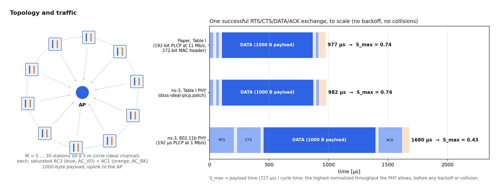
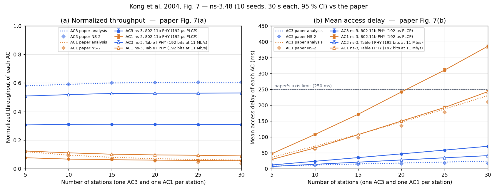

# A4 — Baseline Reproduction: Kong et al. Fig. 7 in ns-3

**Path:** Advanced — own topic (IEEE 802.11e EDCA, ns-3 WiFi) · **Topic:** Optimal QoS policy under different traffic models

**Result reproduced:** Fig. 7 of Z. Kong, D. H. K. Tsang, B. Bensaou, D. Gao, "Performance analysis of IEEE 802.11e contention-based channel access," *IEEE JSAC*, vol. 22, no. 10, pp. 2095–2106, Dec. 2004, DOI [10.1109/JSAC.2004.836019](https://doi.org/10.1109/JSAC.2004.836019). The figure shows the normalized throughput and the mean access delay of two EDCA access categories against the number of stations.

**Why this result:** It is the paper's validation figure: analysis and NS-2 simulation side by side, with every EDCA parameter listed in its Table I. It is also the saturated, two-class EDCA network that the final project starts from (see the A3 revised proposal). That project replaces saturation with realistic traffic, so it first needs a baseline whose numbers are understood.

**Outcome in one paragraph.** The prioritization reproduces in ns-3.48: AC3 throughput stays flat, AC1 throughput falls, and AC1 delay grows much faster than AC3 delay. With ns-3's standard 802.11b PHY, the absolute numbers are far off; AC3 throughput is about half the paper's. Sending the PHY header the way the paper's Table I accounts for it (a 24-line patch to ns-3) removes most of that gap:
- AC1 delay then matches the paper's analysis curve within 6 % for M = 15–30 (8 % at M = 10).
- AC3 throughput comes within 13 %.

Two differences remain:
- ns-3 gives AC3 a smaller share of the channel than the paper.
- The paper's AC3 delays are lower than its own throughput allows under Little's law.

The second one cannot be closed by any parameter choice.

| File | Purpose |
|---|---|
| [`codes/a4/kong-edca.cc`](codes/a4/kong-edca.cc) | ns-3.48 scenario: 1 AP + M stations, saturated AC3 + AC1, Table I EDCA parameters |
| [`codes/a4/dsss-ideal-plcp.patch`](codes/a4/dsss-ideal-plcp.patch) | Optional patch to `DsssPhy`: send the 192-bit PLCP at 11 Mb/s, as the paper does (enabled per run with `--idealPlcp=1`) |
| [`codes/a4/run_sweep.sh`](codes/a4/run_sweep.sh) | Runs the 120-run sweep inside the A2 container and merges the results |
| [`codes/a4/kong_fig7_sweep.csv`](codes/a4/kong_fig7_sweep.csv) | Raw results: one line per run (2 PHY variants × 6 values of M × 10 seeds) |
| [`codes/a4/kong_aifs_sensitivity.csv`](codes/a4/kong_aifs_sensitivity.csv) | Raw results of the AIFS sensitivity test in §5.2 |
| [`codes/a4/plot_fig7.py`](codes/a4/plot_fig7.py) | Plots ns-3 against the paper's Fig. 7 and draws the explanation figure |
| [`codes/a4/draw_setup.py`](codes/a4/draw_setup.py), [`draw_flowchart.py`](codes/a4/draw_flowchart.py) | Setup figure (topology + frame timing) and flowchart |
| [`codes/a4/xiao_model.py`](codes/a4/xiao_model.py), [`plot_xiao.py`](codes/a4/plot_xiao.py) | Supplementary analytical check of the second A3 paper (§7) |

---

## 1. The result being reproduced

Fig. 7 has two panels, both against the number of stations M = 5…30. Each station runs one AC3 (high priority) and one AC1 (low priority) flow, both saturated:

- **Fig. 7(a):** normalized throughput of each AC, on a y-axis from 0 to 1.
- **Fig. 7(b):** mean access delay of each AC in ms, on a y-axis from 0 to 250.

Each panel shows the analytical curve and NS-2 simulation points. The values below were read off the figure by eye; the reading error is about ±0.01 in throughput and ±3 ms in delay.

| M | 5 | 10 | 15 | 20 | 25 | 30 |
|---|---|---|---|---|---|---|
| S_AC3, analysis (NS-2 ≈ same) | 0.58 | 0.59 | 0.60 | 0.603 | 0.605 | 0.605 |
| S_AC1, analysis | 0.12 | 0.095 | 0.08 | 0.07 | 0.065 | 0.06 |
| S_AC1, NS-2 | 0.12 | 0.09 | 0.07 | 0.055 | 0.045 | 0.035 |
| D_AC3 [ms], analysis / NS-2 | 8 / 6 | 12 / 11 | 15 / 14 | 18 / 16 | 21 / 18 | 24 / 17 |
| D_AC1 [ms], analysis / NS-2 | 36 / 28 | 71 / 62 | 108 / 97 | 147 / 135 | 188 / 178 | 230 / 210 |

The paper defines the mean access delay as "the average time between the first transmission attempt of a packet until it is successfully transmitted" (§IV-B).

## 2. Simulation setup



| Item | Paper (Table I, §V) | ns-3.48 | Note |
|---|---|---|---|
| Topology | infrastructure, M stations, ideal channel | 1 AP + M STAs on a 5 m circle, `YansWifiChannel` default, `ConstantPositionMobilityModel` | no frame errors and no hidden nodes at 5 m |
| M | 5…30 | 5, 10, 15, 20, 25, 30 | |
| Traffic | saturated; one AC3 + one AC1 per station; payload 1000 B | 2 × `PacketSocketClient` per STA, 1000 B every 2 ms (4 Mb/s each, far above what an AC can get); `Priority` 6 → AC_VO = AC3, 1 → AC_BK = AC1 | uplink to the AP |
| Data / control rate | 11 Mb/s | 802.11b, `ConstantRateWifiManager`, DataMode = ControlMode = `DsssRate11Mbps` | |
| PHY header | 192 bits at the channel rate (≈ 17.5 µs) | **variant A:** standard long PLCP, 192 µs at 1 Mb/s · **variant B:** 192 bits at 11 Mb/s via `dsss-ideal-plcp.patch` | §5.1 |
| MAC header | 272 bits (34 B) | QoS header + FCS 30 B + LLC/SNAP 8 B = 38 B | +0.4 % frame time |
| RTS / CTS / ACK | PHY + 160 / 112 / 112 bits | 20 / 14 / 14 B | identical |
| Slot / SIFS | 20 µs / 1 slot | 20 µs; `WifiPhy::SetSifs(20 µs)` (802.11b default is 10 µs) | |
| AIFS | AC3 3 slots, AC1 4 slots | `Aifsns` {2} (VO), {3} (BK); AIFS = SIFS + AIFSN × slot | §5.2 tests other offsets |
| CW | AC3 {15, 31, 63, 127}, AC1 {31, 63, 127, 255} | `MinCws` / `MaxCws` 15/127 (VO), 31/255 (BK), on AP and STAs | |
| Access | RTS/CTS, one frame per TXOP | `RtsCtsThreshold` = 0, `TxopLimits` = {0} | |
| Retry limit | m + h, **not reported** | `FrameRetryLimit` = 7 | no frame reached it in any run |
| Simulation time | **not reported** | 33 s: association 0–2 s, traffic from 2 s, statistics 3–33 s | A3 §1.4, "Association" |
| Runs | **not reported** | 10 seeds per point | |

**Metrics, as computed in [`kong-edca.cc`](codes/a4/kong-edca.cc):**
- **Normalized throughput S:** payload bits received at the AP per AC during 3–33 s, divided by 30 s × 11 Mb/s.
- **Mean access delay D:** per station and AC, the time from the moment a frame reaches the head of the MAC queue to its ACK. It is measured with the `AckedMpdu` and `DroppedMpdu` traces. Under saturation the queue is never empty, so a frame reaches the head the instant its predecessor is ACKed or dropped. Each run averages 2 200–22 000 frames per AC.

### Flowchart


## 3. How to repeat it

| | |
|---|---|
| Simulator | ns-3.48, commit `d2add90b4` (2026-06-02), optimized build |
| Platform | Docker image `ns3lab` from A2 ([`codes/a2/Dockerfile`](codes/a2/Dockerfile)): Ubuntu 24.04.5, g++ 13.3.0; host Linux 6.8, 20 cores |
| ns-3 modification | [`dsss-ideal-plcp.patch`](codes/a4/dsss-ideal-plcp.patch), active only when the environment variable `NS3_DSSS_IDEAL_PLCP` is set, which `--idealPlcp=1` does |
| Random numbers | `RngSeedManager::SetSeed(1)`, `SetRun(seed)` with seed = 1…10 |
| Runs | 2 PHY variants × 6 values of M × 10 seeds = **120 runs** for Fig. 7, plus 18 runs for §5.2 |
| Error bars | 95 % confidence interval of the mean over the 10 seeds, 1.96 · s / √10 |

```bash
# host: put the A4 files where the container sees them (~/ns3-work is mounted at /work)
mkdir -p ~/ns3-work/a4 && cp codes/a4/{kong-edca.cc,dsss-ideal-plcp.patch,run_sweep.sh} ~/ns3-work/a4/

# container: patch, build, run, merge
docker exec -it ns3 bash
cd /work/ns-3-dev
git apply /work/a4/dsss-ideal-plcp.patch
cp /work/a4/kong-edca.cc scratch/ && ./ns3 build kong-edca
./ns3 run "kong-edca --nSta=15 --seed=1 --idealPlcp=1"   # one point
bash /work/a4/run_sweep.sh 16                             # 120 runs, 16 in parallel

# host: plots
cp ~/ns3-work/a4/kong_fig7_sweep.csv codes/a4/
python3 codes/a4/plot_fig7.py      # a4_fig7_reproduction.png, a4_explain.png
python3 codes/a4/draw_setup.py     # a4_setup.png
python3 codes/a4/draw_flowchart.py # a4_flowchart.png
```

One line of output per run:

```
M,seed,ideal_plcp,retry,S_ac3,S_ac1,D_ac3_ms,D_ac1_ms,n_ac3,n_ac1,drop_ac3,drop_ac1,Dall_ac3_ms,Dall_ac1_ms,associated
15,1,1,7,0.52...,0.10...,20.7...,107...,21715,4198,0,0,20.7...,107...,15
```

## 4. Result



Both panels use the paper's x-axis (5–30) and labels. Panel (a) keeps the paper's y-axis (0–1). Panel (b) extends the y-axis from 250 to 450 ms, because AC1 with the standard PHY goes past the paper's limit; the dashed line marks 250 ms.

| M | | S_AC3 | S_AC1 | D_AC3 [ms] | D_AC1 [ms] |
|---|---|---|---|---|---|
| 5 | paper analysis | 0.58 | 0.12 | 8 | 36 |
| | ns-3 A: 802.11b PHY | 0.307 | 0.077 | 11.9 | 47.3 |
| | ns-3 B: Table I PHY | 0.508 | 0.124 | 7.2 | 29.3 |
| 15 | paper analysis | 0.60 | 0.08 | 15 | 108 |
| | ns-3 A | 0.311 | 0.063 | 35.1 | 171.6 |
| | ns-3 B | 0.526 | 0.102 | 20.7 | 107.2 |
| 30 | paper analysis | 0.605 | 0.06 | 24 | 230 |
| | ns-3 A | 0.309 | 0.056 | 70.7 | 385.6 |
| | ns-3 B | 0.530 | 0.090 | 41.2 | 242.8 |

The 95 % confidence intervals are at most ±0.002 in throughput (±2.4 % of the AC1 value), ±0.2 ms for AC3 delay, and ±6.5 ms for AC1 delay. They are drawn in the figure but are smaller than most markers.

**What matches:**
- The shape of all four curves: AC3 throughput flat in M, AC1 throughput falling, both delays growing linearly, AC1's much faster.
- With the Table I PHY (variant B), AC1 delay agrees with the analysis curve within 6 % for M = 15…30 and within 8 % at M = 10 (65.5 vs 71, 107.2 vs 108, 150.2 vs 147, 192.8 vs 188, 242.8 vs 230 ms).
- AC1 throughput at M = 5 (0.124 vs 0.12) and AC3 delay at M = 5 (7.2 vs 8 ms) also agree.

**What does not match:**
- AC3 throughput is 12–13 % lower than the paper's.
- AC1 throughput falls more slowly than in the paper (0.090 vs 0.06 at M = 30).
- AC3 delay grows to 41 ms instead of 24 ms.

## 5. Explaining the differences


### 5.1 Parameter mismatch: the paper's PHY is idealized (explains the factor ≈ 1.7)

Table I lists the PHY header as "192 bits" at one 11 Mb/s rate, so every frame pays ≈ 17.5 µs for it. Real 802.11b, and therefore ns-3, sends the long PLCP preamble and header at 1 Mb/s: 192 µs per frame, four times per RTS/CTS/DATA/ACK exchange. Drawn to scale in the setup figure:

| | one exchange incl. AIFS[AC3] | upper bound on S (727 µs payload / exchange) |
|---|---|---|
| Paper, Table I | 977 µs | 0.745 |
| ns-3, Table I PHY (variant B) | 982 µs | 0.741 |
| ns-3, 802.11b PHY (variant A) | 1 680 µs | 0.433 |

The bound predicts that variant B should carry 0.741 / 0.433 = **1.71×** the throughput of variant A. The measured ratio of AC3 throughput is 0.530 / 0.309 = **1.72** at M = 30, and 1.66–1.72 over all M. With the PHY cost matched, AC1 delay lands on the paper's curve. This one parameter therefore explains most of the gap, and it is a parameter mismatch rather than a modelling error.

*Correction to A3:* the PHY-header note in A3 §1.4 first quoted ≈ 1 475 µs and 0.49 for the real PHY. The full computation here, with AIFS and ns-3's 38-byte MAC overhead, gives 1 680 µs and 0.43. A3 has been corrected.

### 5.2 Unmodelled effect: ns-3 differentiates less than the paper's model (2.5–6.3 points of share)

Panel (a) of the explanation figure divides out the PHY overhead by plotting AC3's share of the total throughput, S_AC3 / (S_AC3 + S_AC1):

- ns-3, both PHY variants: 0.80 → 0.85.
- Paper analysis: 0.83 → 0.91.
- Paper NS-2 points: up to 0.95.

That the two ns-3 variants agree with each other confirms the share is independent of the PHY. The remaining difference is in the MAC: ns-3 lets AC1 win more often than the paper's model does. Candidate causes, and what testing them showed:

| Candidate | Test | Result |
|---|---|---|
| AIFS offset: Kong decrements the counter in the last AIFS slot, so the effective AIFS may differ by one slot | AIFSN (AC3, AC1) = (1, 2), (2, 3), (3, 4); M = 15 and 30; 3 seeds each ([`kong_aifs_sensitivity.csv`](codes/a4/kong_aifs_sensitivity.csv)) | total throughput changes by ±3 %, but the AC3 share stays at 0.838–0.842 (M = 15) and 0.853–0.856 (M = 30) — **not the cause** |
| Retry limit (not reported) | drop counters in every run | 0 frames dropped at retry limit 7 in all 120 runs — **not the cause** for limits ≥ 7 |
| MAC header 38 B vs 34 B | frame-time arithmetic | 0.4 % of the exchange — **negligible** |
| The model's approximations: constant, independent collision probability per AC, and a fixed-point solution | not testable in ns-3 | **open**. The paper's own NS-2 points sit even further from ns-3 (AC1 0.035 vs analysis 0.06 at M = 30), so the paper's analysis and simulation do not agree on this either. |
| The 2004 NS-2 802.11e module behaving differently from ns-3's EDCA | would need that module | **open** |

### 5.3 Different metric definition: the paper's delays break Little's law

Under saturation, each AC queue at each station always holds a frame. Little's law then fixes the mean time a frame spends at the head of the queue:

  D = M · L / (S · R),  with L = 8000 payload bits and R = 11 Mb/s,

with no freedom left once the throughput S is known. Panel (b) of the explanation figure plots each reported delay against this value:

- **ns-3, both variants:** every point lies on the line, with ratios 0.989–1.001. This is the consistency check the measurement should pass, and it does.
- **Paper analysis:** the ratio falls from 1.28 (M = 5) to 0.67 (AC3) and 0.63 (AC1) at M = 30.
- **Paper NS-2:** the ratio falls from 0.96 to 0.47 (AC3) and 0.34 (AC1).

So at large M, the paper reports delays that are too short for its own throughput under a head-of-line-to-ACK definition. A frame dropped at the retry limit would make the delivered-frame delay longer, not shorter, so drops cannot explain it either. The paper's delay must therefore leave out part of the head-of-line time, for example the initial backoff and freezing before the first attempt, which its wording "from the first transmission attempt" may imply.

No simulation that delivers the paper's throughput can also deliver the paper's AC3 delay under the definition used here. This is why ns-3 AC3 delay (41 ms) stays above the paper's (24 ms) even with the PHY matched. AC1 delay happens to match in variant B because ns-3's lower AC1 share (§5.2) and the paper's shorter delay definition roughly cancel. The match is real in numbers, but it should not be read as proof of identical behaviour.

### 5.4 Too few runs? No

With 10 seeds × 30 s, the half-width of every 95 % confidence interval is below 2.5 % of the mean, and each delay point averages thousands of frames. None of the differences above are within the noise.

### 5.5 Summary

| Quantity | Match? | Reason |
|---|---|---|
| Shape and ranking of all curves | yes | — |
| Absolute throughput, standard PHY | no, about half | **parameter mismatch:** idealized PHY header (§5.1) |
| Absolute throughput, Table I PHY | AC3 12–13 % lower | remaining share difference (§5.2) |
| AC3 share of throughput | 2.5–6.3 points lower (2.5–5.4 with the Table I PHY) | **unmodelled effect / model approximation**, not AIFS offset, retry limit or header size (§5.2) |
| AC1 delay, Table I PHY | within 6 % (M = 15–30), 8 % at M = 10 | partly coincidental (§5.3) |
| AC3 delay | up to 1.7× higher (M = 30) | **different metric definition:** the paper's delay is below the Little's-law bound (§5.3) |

## 6. What the final project takes from this baseline

- **Use variant A (standard 802.11b PHY) for all new results.** It is protocol-accurate. Variant B exists only to show that the gap to the paper is explained.
- **Fix one delay definition:** head-of-line to ACK, checked against Little's law. The project's traffic models (Poisson, MMPP, 3GPP XR) are not saturated, so queueing delay will be added on top and reported separately.
- **Compare by share, ratios and trends, not by absolute values,** when relating results to the paper.
- **Keep 10 seeds × 30 s.** It gives confidence intervals below 2.5 %; one 33 s run at M = 30 takes 45–65 s of wall time on one core, so the 120-run sweep fits in minutes when run in parallel.

## 7. Supplementary: analytical check of Xiao (IEEE TWC 2005)

The second A3 paper, Y. Xiao, "Performance analysis of priority schemes for IEEE 802.11 and IEEE 802.11e wireless LANs," *IEEE Trans. Wireless Commun.*, vol. 4, no. 4, pp. 1506–1515, Jul. 2005, DOI [10.1109/TWC.2005.850328](https://doi.org/10.1109/TWC.2005.850328), was reproduced analytically, not in ns-3. ns-3 hard-codes the doubling of CW (`Txop::UpdateFailedCw`), so Xiao's window-increasing factor σ = 1.7 needs another patch; this is left for the project.

[`xiao_model.py`](codes/a4/xiao_model.py) implements eqs. (1)–(21) with standard 802.11a timing at 6 Mb/s (slot 9 µs, SIFS 16 µs, DIFS 34 µs, 20 µs preamble + SIGNAL, 28-byte MAC header + FCS, 14-byte ACK):

| | n | this model | paper analysis | error | paper's own sim-vs-analysis error |
|---|---|---|---|---|---|
| S, class 0 | 10 | 0.5150 | 0.5208 | −1.1 % | −0.9 % |
| S, class 1 | 10 | 0.1538 | 0.1547 | −0.6 % | −1.0 % |
| delay, class 0 | 10 | 24.4 ms | 25.1 ms | −2.6 % | +1.8 % |
| delay, class 1 | 10 | 85.9 ms | 86.5 ms | −0.7 % | +2.2 % |
| S, class 0 | 30 | 0.4585 | 0.4659 | −1.6 % | −0.5 % |
| S, class 1 | 30 | 0.1004 | 0.1013 | −0.9 % | −0.5 % |
| delay, class 0 | 30 | 66.7 ms | 67.0 ms | −0.4 % | +1.1 % |
| delay, class 1 | 30 | 343.3 ms | 342.3 ms | +0.3 % | +1.9 % |

The mean error is **1.0 %**, the same size as the paper's own simulation-vs-analysis error. The residual comes from PHY constants the paper does not report.


Figs. 2–5 and 9 match. Fig. 7 does not: at σ₁ = 1.6 the model gives 0.24 where the paper shows ≈ 0.18. The paper is also inconsistent with itself there; see A3 §2.4.

```bash
python3 codes/a4/xiao_model.py   # Table I comparison
python3 codes/a4/plot_xiao.py    # xiao_*.png
```

## References

1. Z. Kong, D. H. K. Tsang, B. Bensaou, and D. Gao, "Performance analysis of IEEE 802.11e contention-based channel access," *IEEE J. Sel. Areas Commun.*, vol. 22, no. 10, pp. 2095–2106, Dec. 2004, doi: 10.1109/JSAC.2004.836019.
2. Y. Xiao, "Performance analysis of priority schemes for IEEE 802.11 and IEEE 802.11e wireless LANs," *IEEE Trans. Wireless Commun.*, vol. 4, no. 4, pp. 1506–1515, Jul. 2005, doi: 10.1109/TWC.2005.850328.
3. IEEE Std 802.11-2016, §16.2.2 (DSSS PPDU formats: long PLCP preamble and header at 1 Mb/s, 192 µs).
4. J. D. C. Little, "A proof for the queuing formula L = λW," *Operations Research*, vol. 9, no. 3, pp. 383–387, 1961.
