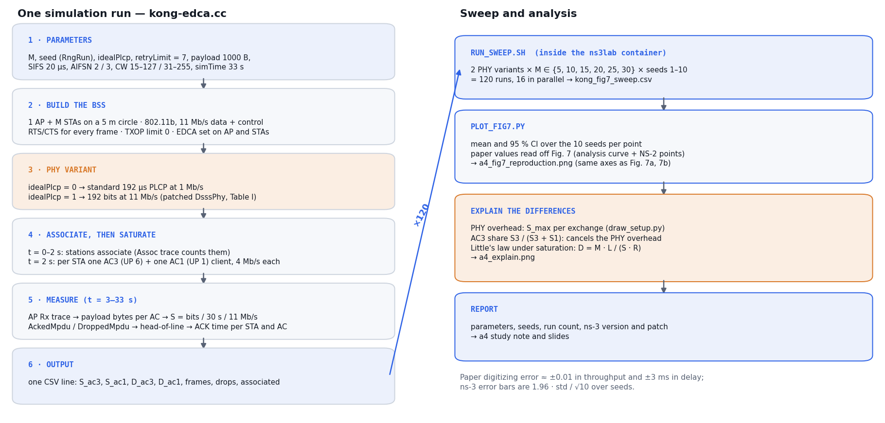
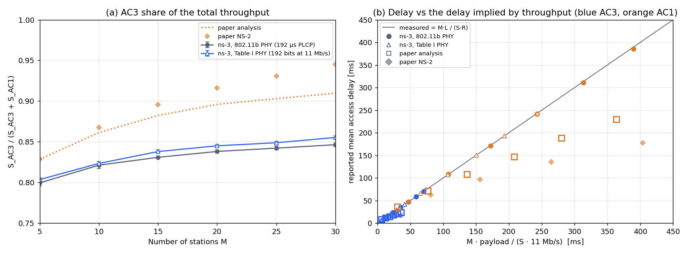
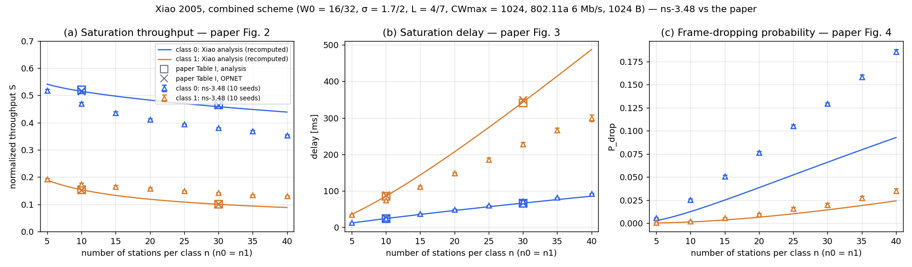
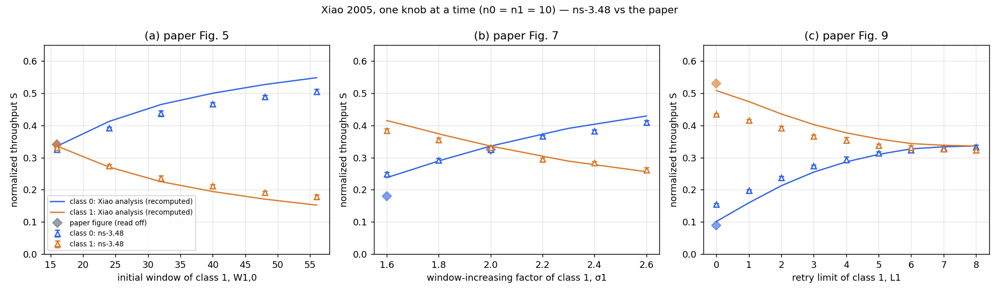
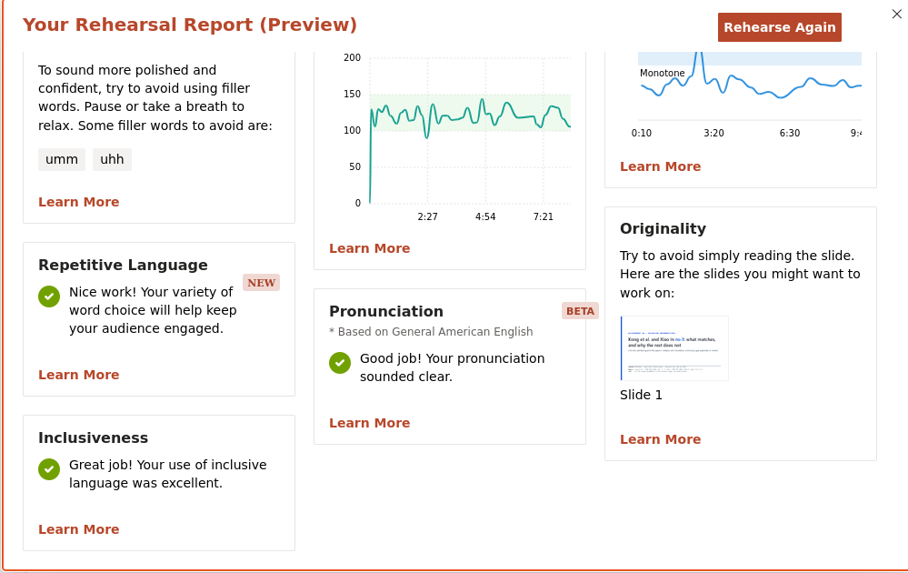

# A4 — Baseline Reproduction: Kong et al. and Xiao in ns-3

**Path:** Advanced — own topic (IEEE 802.11e EDCA, ns-3 WiFi) · **Topic:** Optimal QoS policy under different traffic models

This note reproduces in ns-3.48 one figure of each A3 paper:
- **Main baseline:** Fig. 7 of Z. Kong, D. H. K. Tsang, B. Bensaou, D. Gao, "Performance analysis of IEEE 802.11e contention-based channel access," *IEEE JSAC*, vol. 22, no. 10, pp. 2095–2106, Dec. 2004, DOI [10.1109/JSAC.2004.836019](https://doi.org/10.1109/JSAC.2004.836019). It shows per-AC throughput and access delay against the number of stations (Part I).
- **Second paper:** Table I and Figs. 2–5, 7, 9 of Y. Xiao, "Performance analysis of priority schemes for IEEE 802.11 and IEEE 802.11e wireless LANs," *IEEE Trans. Wireless Commun.*, vol. 4, no. 4, pp. 1506–1515, Jul. 2005, DOI [10.1109/TWC.2005.850328](https://doi.org/10.1109/TWC.2005.850328). These show per-class throughput, delay and frame-dropping probability under the backoff knobs (Part II).

**Why these results:** Kong's Fig. 7 is the paper's validation figure: analysis and NS-2 side by side, with every EDCA parameter in its Table I. It is also the saturated two-class EDCA network that the final project starts from. Xiao's figures cover the knobs the project will tune (initial window, window-increasing factor σ, retry limit), and Table I gives exact numbers from both analysis and OPNET simulation.

**Outcome.**
- **Kong:** the prioritization reproduces. The absolute values depend on two settings the paper fixes differently from real 802.11b or does not report:
  - **PHY header.** Sent the way Table I accounts for it, AC3 throughput comes within 12–13 % of the paper.
  - **Retry limit.** With 4 transmission attempts, AC3 delay is within 11 % of the analysis for M ≥ 10. With 7 attempts, AC1 delay is within 8 % of the paper's NS-2 points.

  One gap stays open: ns-3 gives AC3 a 2.5–6.3 points smaller share of the channel.
- **Xiao:** each knob moves bandwidth between the classes as in the paper, and total throughput is within 2–3.4 % of the model when one knob is varied. With all knobs combined, ns-3 differentiates much less:
  - class-0 throughput is 9–18 % lower than Table I's OPNET values;
  - class-1 throughput is 13–41 % higher.

  ns-3's per-attempt collision probability is higher than the model's (0.66 vs 0.58 at n = 30), and the small class-0 retry limit amplifies this into twice the frame drops.

| File | Purpose |
|---|---|
| [`codes/a4/kong-edca.cc`](codes/a4/kong-edca.cc) | ns-3.48 scenario for Kong: 1 AP + M stations, saturated AC3 + AC1, Table I EDCA parameters |
| [`codes/a4/dsss-ideal-plcp.patch`](codes/a4/dsss-ideal-plcp.patch) | Patch to `DsssPhy`: send the 192-bit PLCP at 11 Mb/s as Kong's Table I does (per run with `--idealPlcp=1`) |
| [`codes/a4/run_sweep.sh`](codes/a4/run_sweep.sh) | Kong sweep: 3 variants × 6 values of M × 10 seeds = 180 runs |
| [`codes/a4/kong_fig7_sweep.csv`](codes/a4/kong_fig7_sweep.csv) | Kong raw results, one line per run |
| [`codes/a4/run_sensitivity.sh`](codes/a4/run_sensitivity.sh), [`kong_aifs_sensitivity.csv`](codes/a4/kong_aifs_sensitivity.csv), [`kong_retry_sensitivity.csv`](codes/a4/kong_retry_sensitivity.csv) | Kong sensitivity tests (§5.2, §5.3): 48 runs and raw results |
| [`codes/a4/plot_fig7.py`](codes/a4/plot_fig7.py) | Kong: ns-3 against the paper's Fig. 7, and the explanation figure |
| [`codes/a4/draw_setup.py`](codes/a4/draw_setup.py), [`draw_flowchart.py`](codes/a4/draw_flowchart.py) | Kong setup figure (topology + frame timing) and flowchart |
| [`codes/a4/xiao-priority.cc`](codes/a4/xiao-priority.cc) | ns-3.48 scenario for Xiao: n₀ + n₁ DCF stations, per-class W₀, σ, retry limit |
| [`codes/a4/txop-cw-growth.patch`](codes/a4/txop-cw-growth.patch) | Patch to `Txop`: attribute `CwGrowthFactor` (σ); the default 2 keeps standard behaviour |
| [`codes/a4/run_xiao_sweep.sh`](codes/a4/run_xiao_sweep.sh), [`xiao_sweep.csv`](codes/a4/xiao_sweep.csv) | Xiao sweep (29 points × 10 seeds = 290 runs) and raw results |
| [`codes/a4/xiao_model.py`](codes/a4/xiao_model.py), [`plot_xiao_ns3.py`](codes/a4/plot_xiao_ns3.py) | Xiao's analytical model, eqs. (1)–(21), and the plots of ns-3 against the paper |
| [`codes/a4/build_slides.py`](codes/a4/build_slides.py) | Builds [`assets/ppt/a4-M11402804-AhmadRifqi.pptx`](assets/ppt/a4-M11402804-AhmadRifqi.pptx) |

---

# Part I — Kong et al., Fig. 7

## 1. The result being reproduced

Fig. 7 has two panels, both against the number of stations M = 5…30. Each station runs one AC3 (high priority) and one AC1 (low priority) flow, both saturated:

- **Fig. 7(a):** normalized throughput of each AC, on a y-axis from 0 to 1.
- **Fig. 7(b):** mean access delay of each AC in ms, on a y-axis from 0 to 250.

Each panel shows the analytical curve and NS-2 simulation points. The values below were read off the figure by eye; the reading error is about ±0.01 in throughput and ±3 ms in delay.

| M | 5 | 10 | 15 | 20 | 25 | 30 |
|---|---|---|---|---|---|---|
| S_AC3, analysis (NS-2 ≈ same) | 0.58 | 0.59 | 0.60 | 0.603 | 0.605 | 0.605 |
| S_AC1, analysis | 0.12 | 0.095 | 0.08 | 0.07 | 0.065 | 0.06 |
| S_AC1, NS-2 | 0.12 | 0.09 | 0.07 | 0.055 | 0.045 | 0.035 |
| D_AC3 [ms], analysis / NS-2 | 8 / 6 | 12 / 11 | 15 / 14 | 18 / 16 | 21 / 18 | 24 / 17 |
| D_AC1 [ms], analysis / NS-2 | 36 / 28 | 71 / 62 | 108 / 97 | 147 / 135 | 188 / 178 | 230 / 210 |

The paper defines the mean access delay as "the average time between the first transmission attempt of a packet until it is successfully transmitted" (§IV-B).

## 2. Simulation setup


| Item | Paper (Table I, §V) | ns-3.48 | Note |
|---|---|---|---|
| Topology | infrastructure, M stations, ideal channel | 1 AP + M STAs on a 5 m circle, `YansWifiChannel` default, `ConstantPositionMobilityModel` | no frame errors and no hidden nodes at 5 m |
| M | 5…30 | 5, 10, 15, 20, 25, 30 | |
| Traffic | saturated; one AC3 + one AC1 per station; payload 1000 B | 2 × `PacketSocketClient` per STA, 1000 B every 2 ms (4 Mb/s each, far above what an AC can get); `Priority` 6 → AC_VO = AC3, 1 → AC_BK = AC1 | uplink to the AP |
| Data / control rate | 11 Mb/s | 802.11b, `ConstantRateWifiManager`, DataMode = ControlMode = `DsssRate11Mbps` | |
| PHY header | 192 bits at the channel rate (≈ 17.5 µs) | standard long PLCP, 192 µs at 1 Mb/s, **or** 192 bits at 11 Mb/s via `dsss-ideal-plcp.patch` | §5.1 |
| MAC header | 272 bits (34 B) | QoS header + FCS 30 B + LLC/SNAP 8 B = 38 B | +0.4 % frame time |
| RTS / CTS / ACK | PHY + 160 / 112 / 112 bits | 20 / 14 / 14 B | identical |
| Slot / SIFS | 20 µs / 1 slot | 20 µs; `WifiPhy::SetSifs(20 µs)` (802.11b default is 10 µs) | |
| AIFS | AC3 3 slots, AC1 4 slots | `Aifsns` {2} (VO), {3} (BK); AIFS = SIFS + AIFSN × slot | §5.2 tests other offsets |
| CW | AC3 {15, 31, 63, 127}, AC1 {31, 63, 127, 255} | `MinCws` / `MaxCws` 15/127 (VO), 31/255 (BK), on AP and STAs | |
| Access | RTS/CTS, one frame per TXOP | `RtsCtsThreshold` = 0, `TxopLimits` = {0} | |
| Retry limit | m + h, **not reported** | `FrameRetryLimit` = 7 attempts (ns-3 default) **or** 4 attempts | §5.3 |
| Simulation time | **not reported** | 33 s: association 0–2 s, traffic from 2 s, statistics 3–33 s | A3 §1.4, "Association" |
| Runs | **not reported** | 10 seeds per point | |
| Association | none (NS-2 has no association phase) | `StaWifiMac::MaxMissedBeacons` = 10⁶ | with 2–3 attempts or AIFSN 1 the channel is busy enough to lose 10 beacons in a row; the default would make stations re-associate mid-run |

Three variants are run. Each one changes a single setting that the paper does not pin to real 802.11b:

| Variant | PHY header | Retry limit |
|---|---|---|
| **A** | standard 802.11b (192 µs) | 7 attempts |
| **B** | Table I (192 bits at 11 Mb/s) | 7 attempts |
| **C** | Table I | 4 attempts, one per CW value listed in Table I |

**Metrics, as computed in [`kong-edca.cc`](codes/a4/kong-edca.cc):**
- **Normalized throughput S:** payload bits received at the AP per AC during 3–33 s, divided by 30 s × 11 Mb/s.
- **Mean access delay D:** per station and AC, the time from the moment a frame reaches the head of the MAC queue to its ACK, for delivered frames. It is measured with the `AckedMpdu` and `DroppedMpdu` traces. Under saturation the queue is never empty, so a frame reaches the head the instant its predecessor is ACKed or dropped. Each run averages 2 200–22 000 frames per AC.
- **Frames dropped at the retry limit**, per AC.
- **MAC queue lifetime.** `WifiMacQueue::MaxDelay` is set to 3600 s. With the default 500 ms, saturated queues hold frames older than the lifetime. A head-of-line frame then expires during its retries and is reported as `EXPIRED_LIFETIME` instead of `REACHED_RETRY_LIMIT`. The MAC behaves the same either way, but the drops go uncounted and their time is added to the next frame's delay.

  *Correction:* the first version of this note ran with the default lifetime and reported zero retry-limit drops and delays that were too long. The tables below come from the corrected runs; throughput is identical in both.

### Flowchart



## 3. How to repeat it

| | |
|---|---|
| Simulator | ns-3.48, commit `d2add90b4` (2026-06-02), optimized build |
| Platform | Docker image `ns3lab` from A2 ([`codes/a2/Dockerfile`](codes/a2/Dockerfile)): Ubuntu 24.04.5, g++ 13.3.0; host Linux 6.8, 20 cores |
| ns-3 modifications | [`dsss-ideal-plcp.patch`](codes/a4/dsss-ideal-plcp.patch), active only when the environment variable `NS3_DSSS_IDEAL_PLCP` is set, which `--idealPlcp=1` does; [`txop-cw-growth.patch`](codes/a4/txop-cw-growth.patch) (Part II), which changes nothing at its default |
| Random numbers | `RngSeedManager::SetSeed(1)`, `SetRun(seed)` with seed = 1…10 |
| Runs | 3 variants × 6 values of M × 10 seeds = **180 runs** for Fig. 7; plus 18 runs (AIFS, §5.2) and 30 runs (retry limit, §5.3) |
| Error bars | 95 % confidence interval of the mean over the 10 seeds, 1.96 · s / √10 |
| Run time | one 33 s run at M = 30 takes 45–65 s of wall time on one core; all 518 runs of Parts I and II take 50 min with 16 in parallel |
| Verified | rebuilt from scratch on 2026-11-14: fresh `d2add90b4` checkout + the two patches, all sweeps rerun with the scripts above. `kong_fig7_sweep.csv` and `xiao_sweep.csv` came out bit-identical. |

```bash
# host: put the A4 files where the container sees them (~/ns3-work is mounted at /work)
mkdir -p ~/ns3-work/a4 && cp codes/a4/*.{cc,patch,sh} ~/ns3-work/a4/

# container: patch, build, run, merge
docker exec -it ns3 bash
cd /work/ns-3-dev
git apply /work/a4/dsss-ideal-plcp.patch /work/a4/txop-cw-growth.patch
cp /work/a4/kong-edca.cc /work/a4/xiao-priority.cc scratch/
./ns3 build kong-edca xiao-priority
./ns3 run "kong-edca --nSta=15 --seed=1 --idealPlcp=1 --retryLimit=4"   # one point
bash /work/a4/run_sweep.sh 16        # Kong: 180 runs, 16 in parallel
bash /work/a4/run_sensitivity.sh 16  # Kong: 48 sensitivity runs (§5.2, §5.3)
bash /work/a4/run_xiao_sweep.sh 16   # Xiao: 290 runs (Part II)

# host: plots
cp ~/ns3-work/a4/{kong_fig7_sweep,kong_aifs_sensitivity,kong_retry_sensitivity,xiao_sweep}.csv codes/a4/
python3 codes/a4/plot_fig7.py       # a4_fig7_reproduction.png, a4_explain.png
python3 codes/a4/plot_xiao_ns3.py   # a4_xiao_fig2-4_ns3.png, a4_xiao_knobs_ns3.png
python3 codes/a4/draw_setup.py && python3 codes/a4/draw_flowchart.py
```

One line of output per Kong run (drop_* = frames dropped at the retry limit, Dall_* = head-of-line time over delivered and dropped frames):

```
M,seed,ideal_plcp,retry,S_ac3,S_ac1,D_ac3_ms,D_ac1_ms,n_ac3,n_ac1,drop_ac3,drop_ac1,Dall_ac3_ms,Dall_ac1_ms,associated
30,1,1,7,0.529188,0.0902061,34.4378,200.308,21829,3720,795,154,39.7866,232.445,30
```

## 4. Result


Both panels use the paper's x-axis (5–30) and labels. Panel (a) keeps the paper's y-axis (0–1). Panel (b) extends the y-axis from 250 to 350 ms, because AC1 in variant A goes past the paper's limit; the dashed line marks 250 ms.

| M | | S_AC3 | S_AC1 | D_AC3 [ms] | D_AC1 [ms] | dropped AC3 / AC1 |
|---|---|---|---|---|---|---|
| 5 | paper analysis / NS-2 | 0.58 | 0.12 / 0.12 | 8 / 6 | 36 / 28 | — |
| | A: 802.11b PHY, 7 attempts | 0.307 | 0.077 | 11.8 | 46.7 | 0.02 % / 0.1 % |
| | B: Table I PHY, 7 attempts | 0.508 | 0.124 | 7.1 | 28.9 | 0.03 % / 0.1 % |
| | C: Table I PHY, 4 attempts | 0.508 | 0.125 | 6.8 | 25.9 | 0.8 % / 2.2 % |
| 15 | paper analysis / NS-2 | 0.60 | 0.08 / 0.07 | 15 / 14 | 108 / 97 | — |
| | A | 0.311 | 0.063 | 33.1 | 157.3 | 0.7 % / 1.2 % |
| | B | 0.526 | 0.102 | 19.5 | 96.5 | 0.8 % / 1.6 % |
| | C | 0.528 | 0.100 | 16.1 | 78.9 | 6.7 % / 9.9 % |
| 30 | paper analysis / NS-2 | 0.605 | 0.06 / 0.035 | 24 / 17 | 230 / 210 | — |
| | A | 0.309 | 0.056 | 59.4 | 325.7 | 3.3 % / 3.3 % |
| | B | 0.530 | 0.090 | 34.4 | 198.7 | 3.5 % / 4.1 % |
| | C | 0.529 | 0.088 | 26.2 | 153.5 | 16.7 % / 17.7 % |

The 95 % confidence intervals are at most ±0.002 in throughput (±2.4 % of the AC1 value), ±0.34 ms for AC3 delay and ±6.6 ms for AC1 delay. They are drawn in the figure but are smaller than most markers.

**What matches:**
- The shape of all curves in every variant: AC3 throughput flat in M, AC1 throughput falling, both delays growing linearly, AC1's much faster.
- **Variant B:** AC1 delay agrees with the paper's NS-2 points within 3 % for M ≤ 20 and within 8 % up to M = 30 (28.9 vs 28, 62.1 vs 62, 96.5 vs 97, 131.2 vs 135, 164.1 vs 178, 198.7 vs 210 ms).
- **Variant C:** AC3 delay agrees with the analysis curve within 11 % for M = 10…30 (12.0 vs 12, 16.1 vs 15, 20.0 vs 18, 23.3 vs 21, 26.2 vs 24 ms).
- **Variants B and C:** AC1 throughput at M = 5 (0.124 vs 0.12).

**What does not match:**
- **Variant A:** throughput is about half of the paper's; delays are 1.3–2.5× longer.
- **Variants B and C:** AC3 throughput is 12–13 % lower, and AC1 throughput falls more slowly (0.09 vs 0.06 at M = 30).
- **No single retry limit** matches the AC3 and AC1 delays of the analysis at the same time. Variant B is 11–20 % below the analysis for AC1 and above it for AC3 (M ≥ 10). Variant C matches AC3 but is 27–33 % below for AC1.

## 5. Explaining the differences



### 5.1 Parameter mismatch: the paper's PHY is idealized (explains the factor ≈ 1.7)

Table I lists the PHY header as "192 bits" at one 11 Mb/s rate, so every frame pays ≈ 17.5 µs for it. Real 802.11b, and therefore ns-3, sends the long PLCP preamble and header at 1 Mb/s: 192 µs per frame, four times per RTS/CTS/DATA/ACK exchange. Drawn to scale in the setup figure:

| | one exchange incl. AIFS[AC3] | upper bound on S (727 µs payload / exchange) |
|---|---|---|
| Paper, Table I | 977 µs | 0.745 |
| ns-3, Table I PHY (variants B, C) | 982 µs | 0.741 |
| ns-3, 802.11b PHY (variant A) | 1 680 µs | 0.433 |

The bound predicts that variant B should carry 0.741 / 0.433 = **1.71×** the throughput of variant A. The measured ratio of AC3 throughput is 0.530 / 0.309 = **1.72** at M = 30, and 1.66–1.72 over all M. This one parameter explains most of the gap in absolute values. It is a parameter mismatch, not a modelling error.

*Correction to A3:* the PHY-header note in A3 §1.4 first quoted ≈ 1 475 µs and 0.49 for the real PHY. The full computation here, with AIFS and ns-3's 38-byte MAC overhead, gives 1 680 µs and 0.43. A3 has been corrected.

### 5.2 Unmodelled effect: ns-3 differentiates less than the paper's model (2.5–6.3 points of share)

Panel (a) of the explanation figure divides out the PHY overhead by plotting AC3's share of the total throughput, S_AC3 / (S_AC3 + S_AC1):

- ns-3, all three variants: 0.80 → 0.85.
- Paper analysis: 0.83 → 0.91.
- Paper NS-2 points: up to 0.95.

The three variants agree with each other, so the share does not depend on the PHY or on the retry limit. The difference is in the MAC: ns-3 lets AC1 win more often than the paper's model does. Candidate causes, and what testing them showed:

| Candidate | Test | Result |
|---|---|---|
| AIFS offset: Kong decrements the counter in the last AIFS slot, so the effective AIFS may differ by one slot | AIFSN (AC3, AC1) = (1, 2), (2, 3), (3, 4); M = 15 and 30; 3 seeds each ([`kong_aifs_sensitivity.csv`](codes/a4/kong_aifs_sensitivity.csv)) | total throughput changes by ±3 %, but the AC3 share stays at 0.838–0.842 (M = 15) and 0.853 (M = 30): **not the cause** |
| Retry limit (not reported) | 2, 3, 4, 5, 7 attempts; M = 15 and 30; 3 seeds each ([`kong_retry_sensitivity.csv`](codes/a4/kong_retry_sensitivity.csv)) | share 0.839–0.855 (M = 15) and 0.853–0.872 (M = 30), still below 0.91 even with 53 % of AC3 frames dropped: **not the cause** |
| MAC header 38 B vs 34 B | frame-time arithmetic | 0.4 % of the exchange: **negligible** |
| The model's approximations: constant, independent collision probability per AC, and a fixed-point solution | not testable in ns-3 | **open**. The paper's own NS-2 points sit even further from ns-3 (AC1 0.035 vs analysis 0.06 at M = 30), so the paper's analysis and simulation do not agree on this either. |
| The 2004 NS-2 802.11e module behaving differently from ns-3's EDCA | would need that module | **open** |

### 5.3 Parameter mismatch: the unreported retry limit sets the delay

Under saturation, each AC queue at each station always holds a frame. Little's law then fixes the mean time a frame spends at the head of the queue, averaged over delivered and dropped frames:

  D_all = M · L / (S_attempted · R),  with L = 8000 payload bits and R = 11 Mb/s.

ns-3 meets this exactly: `Dall` / Little = 0.992–1.002 in every variant. That is the consistency check the measurement should pass.

The paper reports the delay of *delivered* frames against *delivered* throughput. The frames dropped at the retry limit are the ones that waited longest, so leaving them out makes the delivered-frame delay shorter than M · L / (S · R). Panel (b) shows each reported delay against that value. Panel (c) shows how the ratio depends on the retry limit:

| D / (M · L / (S · R)) at M = 30 | AC3 | AC1 |
|---|---|---|
| ns-3, 7 attempts (variant B) | 0.84 | 0.82 |
| ns-3, 5 attempts | 0.70 | 0.69 |
| ns-3, 4 attempts (variant C) | 0.64 | 0.62 |
| ns-3, 3 attempts | 0.57 | 0.56 |
| **paper analysis** | **0.67** | **0.63** |
| paper NS-2 | 0.47 | 0.34 |

With 4 attempts, ns-3 reproduces the paper's analysis ratio within 5 % for M ≥ 15: 0.78 vs 0.82, 0.73 vs 0.75, 0.68 vs 0.70 and 0.64 vs 0.67 for AC3. The number 4 also follows from the paper itself: Table I lists four contention windows per AC ({15, 31, 63, 127} and {31, 63, 127, 255}), i.e. backoff stages 0…3 and m + h = 3 retransmissions. The paper's NS-2 points need even more drops, about 2–3 attempts, or a delay that starts later. Under the head-of-line definition used here, no single retry limit fits both.

So the "short" delays in Fig. 7(b) are mostly explained by retry-limit drops, a parameter the paper does not report, rather than by a different delay definition. The remaining AC1 delay gap in variant C (27–33 % below the analysis) follows from §5.2. ns-3 delivers 47 % more AC1 throughput (0.088 vs 0.06), and Little's law turns that into a correspondingly shorter delay. The AC1 delay match of variant B with the NS-2 points is the combination of both effects. It is real in numbers, but it is not proof of identical behaviour.

### 5.4 Different traffic model? No

The paper's traffic model is saturation: every AC queue always holds a frame. ns-3 offers 4 Mb/s per AC per station, more than an AC can obtain even at M = 5 (at most 0.53 × 11 Mb/s = 5.8 Mb/s for all M AC3 flows together), so every queue stays backlogged for the whole statistics window. The packet size (1000 B) and the direction (uplink to the AP) are the paper's. Traffic is therefore not a source of the differences. Non-saturated traffic is what the final project adds.

### 5.5 Too few runs? No

With 10 seeds × 30 s, the half-width of every 95 % confidence interval is below 2.5 % of the mean, and each delay point averages thousands of frames. None of the differences above are within the noise.

### 5.6 Summary

| Quantity | Match? | Reason |
|---|---|---|
| Shape and ranking of all curves | yes | — |
| Absolute throughput, 802.11b PHY | no, about half | **parameter mismatch:** idealized PHY header (§5.1) |
| Absolute throughput, Table I PHY | AC3 12–13 % lower | follows from the share difference (§5.2) |
| AC3 share of throughput | 2.5–6.3 points lower | **unmodelled effect / model approximation**; not AIFS offset, retry limit or header size (§5.2) |
| AC3 delay | within 11 % with 4 attempts (M ≥ 10) | **parameter mismatch:** unreported retry limit (§5.3) |
| AC1 delay | within 8 % of NS-2 with 7 attempts; 27–33 % below the analysis with 4 | retry limit (§5.3) plus the share difference (§5.2) |

---

# Part II — Xiao, Table I and Figs. 2–5, 7, 9

## 6. The results being reproduced

Xiao's combined scheme gives class 0 (high priority) and class 1 (low priority) different backoff knobs:

| | W₀ | σ | Retry limit L | CWmax |
|---|---|---|---|---|
| Class 0 | 16 | 1.7 | 4 | 1024 |
| Class 1 | 32 | 2 | 7 | 1024 |

Here L counts retransmissions, so a frame is dropped after L + 1 failures. The PHY is 802.11a at 6 Mb/s for data and control, with 1024-byte frames and basic access. n₀ = n₁ = n stations carry one class each, all saturated.

- **Table I** gives exact analysis and OPNET values at n = 10 and 30 (the targets below).
- **Figs. 2–4** plot throughput, delay and frame-dropping probability against n = 5…40.
- **Figs. 5, 7 and 9** vary one knob of class 1 at n = 10, with everything else equal (W = 16, σ = 2, L = 7):

| Figure | Knob varied | Range |
|---|---|---|
| Fig. 5 | initial window W₁,₀ | 16…56 |
| Fig. 7 | window-increasing factor σ₁ | 1.6…2.6 |
| Fig. 9 | retry limit L₁ | 0…8, with L₀ = 8 |

The curves of Figs. 2–9 are not tabulated in the paper. They are recomputed with [`xiao_model.py`](codes/a4/xiao_model.py), which reproduces Table I's analysis within 1.0 % on average (largest error 2.6 %). The few points that can be read reliably off Figs. 5, 7 and 9 are plotted as well.

## 7. Simulation setup

| Item | Paper (§V–VI, Table I) | ns-3.48 ([`xiao-priority.cc`](codes/a4/xiao-priority.cc)) | Note |
|---|---|---|---|
| Topology | n₀ + n₁ stations, single hop, ideal channel | 1 AP + (n₀ + n₁) STAs on a 5 m circle | no hidden nodes, no frame errors |
| Traffic | saturated, 1024-byte frames | one `PacketSocketClient` per STA, 6 Mb/s offered, uplink | |
| Frame size | 28 B MAC header + FCS + 1024 B = 1052 B | 1016 B payload + 36 B (24 header + 4 FCS + 8 LLC/SNAP) = 1052 B | throughput counted as delivered frames × 1024 B, as in the paper |
| PHY | 802.11a, 6 Mb/s data and control | `WIFI_STANDARD_80211a`, `OfdmRate6Mbps` for both; slot 9 µs, SIFS 16 µs, DIFS 34 µs | |
| Access | basic | `RtsCtsThreshold` = 4692 | |
| MAC | DCF with per-class backoff | non-QoS stations (`QosSupported` = false), so each STA keeps its own CW and does not adopt the AP's EDCA parameters; `Aifsns` {2} = DIFS for all | ns-3 applies the legacy DCF countdown (no extra decrement at the AIFS boundary) to non-QoS stations; checked in `ChannelAccessManager::UpdateBackoff` |
| W₀, CWmax | 16 / 32, 1024 | `MinCws` {15} / {31}, `MaxCws` {1023} | ns-3 stores W − 1 |
| σ | 1.7 / 2 | `ns3::Txop::CwGrowthFactor`, added by [`txop-cw-growth.patch`](codes/a4/txop-cw-growth.patch): after the k-th failure CW = min(CWmax, round(σᵏ · (CWmin + 1)) − 1) | verified with the `CwTrace` source: CW of class 0 goes 15 → 26 → 45 → 78 → 133 |
| Retry limit | L = 4 / 7 retransmissions | `FrameRetryLimit` = L + 1 attempts | ns-3 counts attempts |
| Time | not reported | traffic starts when all stations are associated; statistics from 1 s later, for 20 s | |
| Runs | > 95 % CI | 10 seeds per point | |
| Other | — | `WifiMacQueue::MaxDelay` 3600 s (as in Part I); `StaWifiMac::MaxMissedBeacons` 10⁶, because at L₁ = 0 the channel is busy enough to lose 10 beacons in a row and trigger a re-association that the model does not have | |

**Metrics:**
- **S:** delivered frames × 8192 bits / 20 s / 6 Mb/s.
- **D:** head-of-line → ACK time of delivered frames (Xiao eq. 21).
- **P_drop:** dropped / (delivered + dropped) frames (eq. 16).

**Runs:** 29 points × 10 seeds = **290 runs**:
- Figs. 2–4: 8 values of n;
- Figs. 5 and 7: 6 values each;
- Fig. 9: 9 values.

Each run delivers at least 1 800 frames per class. The 95 % confidence intervals are below 4 % of the mean for every point.

**How to repeat it:** same simulator, container and patches as Part I (§3).
- Random numbers: `RngSeedManager::SetSeed(1)`, `SetRun(seed)` with seed = 1…10.
- One point: `./ns3 run "xiao-priority --n0=30 --n1=30 --seed=1"` (the defaults are the combined scheme: W₀ 16/32, σ 1.7/2, L 4/7, CWmax 1024, 20 s of statistics).
- All 290 runs: `bash /work/a4/run_xiao_sweep.sh 16`, which lists every point's command-line options and merges the output into `xiao_sweep.csv`.

One line of output per run, with the sweep's experiment name in front:

```
exp,n0,n1,seed,W0_0,W0_1,sigma0,sigma1,L0,L1,S0,S1,D0_ms,D1_ms,P0,P1,acked0,acked1,drop0,drop1,associated
fig2-4,30,30,1,16,32,1.7,2,4,7,0.381201,0.139605,71.916,242.785,0.126818,0.0158807,5584,2045,811,33,60
```

## 8. Result



The panels keep the paper's x-axes (n = 5…40) and quantities. Delay is shown in ms instead of the paper's µs. The y-ranges are widened so that the ns-3 points fit: 0–0.7 instead of 0.05–0.55 for throughput, and 0–0.19 instead of 0–0.1 for P_drop.

**Table I**, ns-3 (mean of 10 seeds) against the paper:

| n | | ns-3 | paper analysis | paper OPNET | ns-3 vs OPNET |
|---|---|---|---|---|---|
| 10 | S, class 0 | 0.469 | 0.521 | 0.516 | −9 % |
| | S, class 1 | 0.174 | 0.155 | 0.153 | +13 % |
| | delay, class 0 | 25.3 ms | 25.1 ms | 25.5 ms | −1 % |
| | delay, class 1 | 74.5 ms | 86.5 ms | 88.4 ms | −16 % |
| | P_drop, class 0 / 1 | 0.025 / 0.002 | 0.012 / 0.001 (model) | — | |
| 30 | S, class 0 | 0.380 | 0.466 | 0.464 | −18 % |
| | S, class 1 | 0.142 | 0.101 | 0.101 | +41 % |
| | delay, class 0 | 72.0 ms | 67.0 ms | 67.7 ms | +6 % |
| | delay, class 1 | 228 ms | 342 ms | 349 ms | −35 % |
| | P_drop, class 0 / 1 | 0.130 / 0.020 | 0.066 / 0.014 (model) | — | |



**What matches:**
- **Every knob works in the paper's direction, with the same ordering.**
  - A larger W₁,₀ or σ₁ moves bandwidth to class 0.
  - A smaller L₁ moves it to class 1.
  - Class 0 is always ahead in the combined scheme.
- **Figs. 5 and 7 (one knob at a time):** total throughput is 2.2–3.1 % below the model. Per class, the error is within 8 %, except class 1 at W₁,₀ ≥ 40 (+8 to +17 %).
- **Fig. 7 at σ₁ = 1.6:** ns-3 gives class 0 0.249, close to the model's 0.238, while the paper's figure shows ≈ 0.18. This independently supports A3's finding that Fig. 7 was produced with a setting the paper does not report.
- **Class-0 delay in the combined scheme:** within 1 % of Table I at n = 10 and within 7 % at n = 30.

**What does not match:**
- **Combined scheme (Figs. 2–4):** ns-3 differentiates much less.
  - Class 0 gets 73 % of the throughput at every n, against 74 → 83 % in the model.
  - Class-0 throughput is 9–18 % below Table I; class-1 throughput is 13–41 % above.
  - Class 0 drops about twice as many frames as the model predicts.
- **Fig. 9 at small retry limits:** at L₁ = 0, class 1 gets 0.434 against the model's 0.508 and the paper's ≈ 0.53. Class 0 gets 0.154 against 0.102 and ≈ 0.09.
- **Total throughput** is 3–8 % below the model in the combined scheme, and the gap grows with n.

## 9. Explaining the differences

**One cause: ns-3's per-attempt collision probability p is higher than the model's fixed point.** It was measured directly in three diagnostic runs per setting. A separate build counts the transmissions of each class by retry count (PHY `PhyTxPsduBegin`); P(fail | stage j) = attempts at stage j + 1 / attempts at stage j:

| Setting | p, model | P(fail \| stage j) in ns-3 | P_drop: ns-3 measured vs p_ns-3^(L+1) |
|---|---|---|---|
| Combined, n = 30, class 0 | 0.580 | 0.66, 0.66, 0.67, 0.66 | 0.13 vs 0.66⁵ = 0.125 |
| Combined, n = 30, class 1 | 0.588 | 0.61–0.62 | 0.020 vs 0.61⁸ = 0.019 |
| Equal knobs (plain DCF), n = 10 | 0.416 | 0.44–0.49 | — |

The table supports three conclusions:
1. **The model's structure holds in ns-3.** The failure probability is the same at every backoff stage, so Bianchi's decoupling assumption is not what breaks. The drop probability follows eq. (16), P_drop = p^(L+1), once ns-3's own p is used.
2. **The difference is in the value of p.** For plain DCF with equal knobs, p is ≈ 10 % higher than the model's. This costs 2–3 % of total throughput (Figs. 5, 7, 9 at their centre points).
3. **The combined scheme amplifies it.** Class 0 has only 5 attempts and a slowly growing window (σ = 1.7). Its drop probability p⁵ doubles (0.13 vs 0.066 at n = 30). Dropped frames use airtime but are not counted as throughput, so S₀ falls. Each drop also resets class 0 to its smallest window, which raises collisions further. Class 1, with 8 attempts, rarely drops, so it takes the freed airtime. Its delay is correspondingly shorter (Little's law), which is why class-1 delay is 16–35 % below Table I. The same mechanism makes Fig. 9 deviate most at L₁ = 0–2, where every failure of class 1 is (almost) a drop.

| Category | Candidate | Status |
|---|---|---|
| Unmodelled effect | protocol timing that Bianchi-type chains do not model: after a collision, the colliding stations wait for the ACK timeout (45 µs) and then DIFS, while the others wait EIFS (94 µs); this shifts the slot grids by a non-integer number of slots | **open, most likely**. The model has one collision duration for all stations. OPNET 8.0A matched the model within 1–2 %, so its DCF evidently differs from ns-3's here; that comparison would need OPNET. |
| Parameter mismatch | PHY constants the paper does not report (A3 §2.4) | ≈ 1 % (the analytical re-implementation with standard 802.11a timing is within 1.0 % of Table I): **too small** |
| Parameter mismatch | frame size | matched exactly (PSDU 1052 B): **excluded** |
| Implementation | σ patch, retry semantics | verified with `CwTrace` (CW sequence) and drop counts = p^(L+1): **excluded** |
| Implementation | EDCA's extra decrement at the AIFS boundary | not applied to non-QoS stations (checked in the ns-3 source): **excluded** |
| Different traffic model | saturation, as in the paper: each STA offers 6 Mb/s, the whole channel's rate, and every queue stays backlogged | **excluded** |
| Too few runs | — | CI < 4 % of the mean, 290 runs: **excluded** |

## 10. What the final project takes from these baselines

- **Use the standard 802.11b/802.11a PHY and ns-3's default retry limit for new results**, and report the retry limit. Variants B and C exist to show that the gaps to Kong are explained.
- **Report delivered-frame delay, frame-dropping probability and the head-of-line time of all frames together.** Without the drops, delays are not comparable: the retry limit alone moves Kong's AC3 delay by 25 %. Keep `WifiMacQueue::MaxDelay` long, or the drops are misreported.
- **Do not take the analytical models' absolute values as ground truth under strong differentiation.** Xiao's model is within 3 % for one knob, but 10–40 % off for the combined scheme in ns-3. The models are useful for direction and fast sweeps; the policy search itself runs in ns-3.
- **σ is now available in ns-3** (`CwGrowthFactor`), so the project's policy search can include it next to CWmin, CWmax, AIFSN and the retry limit.
- **Keep 10 seeds per point.** Confidence intervals stay below 2.5 % (Kong) and 4 % (Xiao).

## References

1. Z. Kong, D. H. K. Tsang, B. Bensaou, and D. Gao, "Performance analysis of IEEE 802.11e contention-based channel access," *IEEE J. Sel. Areas Commun.*, vol. 22, no. 10, pp. 2095–2106, Dec. 2004, doi: 10.1109/JSAC.2004.836019.
2. Y. Xiao, "Performance analysis of priority schemes for IEEE 802.11 and IEEE 802.11e wireless LANs," *IEEE Trans. Wireless Commun.*, vol. 4, no. 4, pp. 1506–1515, Jul. 2005, doi: 10.1109/TWC.2005.850328.
3. G. Bianchi, "Performance analysis of the IEEE 802.11 distributed coordination function," *IEEE J. Sel. Areas Commun.*, vol. 18, no. 3, pp. 535–547, Mar. 2000.
4. IEEE Std 802.11-2016, §16.2.2 (DSSS PPDU formats: long PLCP preamble and header at 1 Mb/s, 192 µs).
5. J. D. C. Little, "A proof for the queuing formula L = λW," *Operations Research*, vol. 9, no. 3, pp. 383–387, 1961.

---

## Link to submission files

- **Presentation:** [a4-M11402804-AhmadRifqi.pptx](assets/ppt/a4-M11402804-AhmadRifqi.pptx)
- **Recordings:** [Presentation recordings](https://drive.google.com/file/d/12AIN-xM50AeSdwr058whsjTtVDxD_XW3/view?usp=sharing)
- **Rehearsal:** PowerPoint Speaker Coach, 18 slides in 9:53 at 120 words/min.



